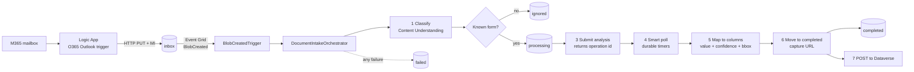

## Document Intake

Email attachments arrive in an M365 mailbox, get classified and OCR'd by Azure AI Foundry
Content Understanding, mapped onto a known form's columns, and pushed to Dataverse — with the
file moving through blob containers that reflect its lifecycle state.

> [!IMPORTANT]
> This project is provided for demonstration and educational purposes only. It is not intended
> for production use without additional review, hardening, security validation, operational
> monitoring, compliance assessment, and testing.

## Architecture



Every Azure-to-Azure hop uses a **system-assigned managed identity**: Function App → Storage,
Function App → Foundry, Logic App → Storage, and Foundry → Storage (so the analyzer can read
the blob URL it is handed). No connection strings or account keys appear in app settings.
The Function App reaches Storage through VNet integration and private endpoints for Blob, Queue,
Table, and File. Storage public network access is disabled.

## Containers

| Container    | Meaning |
| ------------ | ------- |
| `inbox`      | Landing zone written by the Logic App. Event Grid watches this one. |
| `processing` | Classified as a known form; analysis in flight. |
| `ignored`    | Not a known form (or below the classification confidence threshold). |
| `completed`  | Successfully processed; the URL is captured into the Dataverse payload. |
| `failed`     | Any orchestration failure. `intakeReason` blob metadata explains why. |

Moves are copy-then-delete (`StartCopyFromUri` → poll → delete), so a crash mid-move can never
lose a file. `BlobRouter.MoveAsync` treats "source gone, destination present" as success, which
makes retries idempotent.

## Serve a document to a UI

Storage public network access is disabled, so a browser cannot fetch a processed document
directly — not even with a SAS token. `GetDocumentTrigger` proxies the bytes through the Function
App, which reaches Storage over its private endpoints.

```text
GET https://<function-app-name>.azurewebsites.net/api/documents/content?url=<blob url>
x-functions-key: <function key>
```

Pass the `new_completedbloburl` value stored in Dataverse as `url`. A successful call returns the
raw bytes with `Content-Disposition: inline`, so Power Pages can render the document in an
`<iframe>` or `<embed>`.

| Response | When |
| -------- | ---- |
| `200` | Blob found in an allowed container. |
| `400` | Missing `url`, or a url that fails validation. |
| `401` | Missing or wrong function key. |
| `404` | Url is valid but the blob does not exist. |

`BlobUrlValidator` rejects any url that is not HTTPS, does not match the configured storage
account host and port, carries credentials, contains `.` or `..` path segments, or names a
container outside `Containers.PublicViewable` (currently `completed` only). The query string is
discarded, so a caller cannot smuggle in a SAS. Error responses never echo the submitted url.

Only `application/pdf`, `image/png`, `image/jpeg`, `image/tiff`, and `text/plain` are served with
their stored content type. Anything else is downgraded to `application/octet-stream` so a blob
stored as `text/html` or `image/svg+xml` cannot execute as same-origin markup. Responses also set
`X-Content-Type-Options: nosniff` and `Cache-Control: private, no-store`.

> [!WARNING]
> The function key must be attached server-side — from Power Pages Liquid or a plugin. Calling
> this endpoint from browser JavaScript would publish the key to every visitor. The intended
> production shape is Azure API Management in front of the endpoint, handling Entra ID.

## Monitor durable workflows

Durable Functions Monitor provides a read-only dashboard of orchestration instances, activity
history, and failures. Open it at:

```text
https://<function-app-name>.azurewebsites.net/api/durable-functions-monitor
```

For operator access, enable [App Service Authentication](https://learn.microsoft.com/azure/app-service/overview-authentication-authorization)
with Microsoft Entra ID before exposing the monitor.

The monitor requires authentication by default. For a short-lived demo only, add the following
Function App setting, then remove it when the demo ends:

```text
DFM_NONCE=i_sure_know_what_i_am_doing
```

> [!WARNING]
> This setting disables Durable Functions Monitor authentication. Anyone who can reach the
> Function App can view orchestration history while it is set. The monitor remains read-only, but
> it can expose document names and processing details.

## Repo layout

```
infra/                    Bicep, azd-conventional
  main.bicep              subscription scope; creates rg-<env> and wires the modules
  core/                   storage, monitoring, foundry, functionapp, logicapp, eventgrid, rbac
src/DocumentIntake.Functions
  Triggers/               Event Grid entry point + the document content endpoint
  Orchestrations/         the durable orchestrator + polling schedule
  Activities/             classify, move, submit, poll, map, post
  Services/               Content Understanding, blob routing, field mapping, Dataverse
analyzers/contentunderstanding
  document-intake-classifier.json       classifier definition
  document-intake-form-analyzer.json    field schema for the known form
  field-map.json                        analyzer field name -> Dataverse column
scripts/register-analyzers.ps1          PUTs both definitions after provisioning
src/DocumentIntake.Tests                xUnit
```

## Deploy

Authenticate Azure CLI before Azure Developer CLI (`azd`). They keep separate login
contexts; use the same deployment identity and tenant in both, and select the same
subscription in the azd environment.

```powershell
$tenantId = '<deployment-tenant-id>'
$subscriptionId = '<deployment-subscription-id>'
az login --tenant $tenantId
az account set --subscription $subscriptionId
az account show --query '{subscription:id, tenant:tenantId, identity:user.name}'
azd auth login --tenant-id $tenantId
azd up --subscription $subscriptionId
```

`azd up` first runs `scripts/register-providers.ps1` to ensure `Microsoft.App` is
registered in the selected subscription. It skips an existing registration and waits
up to five minutes for a new registration. Missing configuration, authorization failures,
or a timeout stop provisioning. The deployment identity needs permission to register
resource providers in the subscription.

Provisioning creates the Azure AI Services account, its Microsoft Foundry project, and
the model deployments. The `scripts/register-analyzers.ps1` postprovision hook verifies
the Azure CLI tenant and principal object ID against the deployment context and checks
that the endpoint belongs to that account. It reuses an existing **Cognitive Services
User** grant, including a direct inherited grant, or assigns that role at the account
scope. Creating a missing grant requires `Microsoft.Authorization/roleAssignments/write`
at that scope, such as an appropriately scoped RBAC administrator role. Contributor
alone cannot create role assignments. The Function managed identity's separate role
does not authorize the deployment caller.

The scripts resolve explicit parameters first, then process environment values, then
the selected azd environment. The analyzer hook uses `AZURE_SUBSCRIPTION_ID`,
`AZURE_TENANT_ID`, `AZURE_RESOURCE_GROUP`, `AZURE_FOUNDRY_ACCOUNT_NAME`,
`AZURE_PRINCIPAL_ID` (object ID, not application/client ID), and `AZURE_PRINCIPAL_TYPE`
(`User` or `ServicePrincipal`). Caller verification uses `az ad signed-in-user show`
for users or `az ad sp show` for service principals. If directory lookup is blocked,
resolve the identity/login policy with your administrator; the script will not guess
an object ID or grant a different identity access.

Analyzer registration retries transient failures and RBAC propagation for at most ten
attempts and ten minutes per PATCH/PUT operation, with 30-second request timeouts.
Persistent authentication failures and invalid definitions stop immediately. If the
postprovision hook fails, infrastructure may already exist, but `azd up` stops before
application deployment. Correct access and rerun registration, then `azd deploy`;
see [deployment recovery](docs/runbook.md#deployment-hook-recovery). The project endpoint
remains separate for project-scoped Foundry APIs.

If Event Grid setup failed because Azure CLI was signed into the wrong tenant or
subscription, no infrastructure redeployment is needed:

```powershell
az login --tenant $tenantId
az account set --subscription $subscriptionId
./scripts/register-event-subscription.ps1 -SubscriptionId $subscriptionId
```

Two steps still need a human — see [docs/manual-setup.md](docs/manual-setup.md):

1. Authorize the Office 365 API connection (interactive OAuth consent).
2. Decide and configure Dataverse authentication, then set `Dataverse__Enabled=true`.

## Configuration

Set as app settings by `infra/core/functionapp.bicep`; mirror them in `local.settings.json`
(copy `local.settings.json.sample`) when running locally.

| Setting | Purpose |
| ------- | ------- |
| `Storage__BlobServiceUri` | Blob endpoint used by `BlobRouter`. |
| `AzureWebJobsStorage__blobServiceUri` / `__queueServiceUri` / `__tableServiceUri` | Identity-based host storage (Durable Functions needs all three). |
| `ContentUnderstanding__Endpoint` | Azure AI Services endpoint used by Content Understanding (`https://<resource>.cognitiveservices.azure.com`). |
| `Foundry__ProjectEndpoint` | Microsoft Foundry project endpoint (`https://<resource>.services.ai.azure.com/api/projects/<project>`). |
| `ContentUnderstanding__ApiVersion` | Pinned API version (`2025-11-01`). |
| `ContentUnderstanding__ClassifierId` | Classifier to call in step 1. |
| `ContentUnderstanding__AnalyzerId` | Analyzer to call in step 3. |
| `ContentUnderstanding__KnownFormCategory` | Single-category fallback when no category list is configured (default `hipp-application-virginia`). Existing single-category settings remain supported. |
| `ContentUnderstanding__KnownFormCategories__<index>` | Accepted categories as a 0-based indexed list. A nonempty list replaces the single-category fallback. Matching is case-insensitive; confidence must still meet the threshold. |
| `ContentUnderstanding__MinimumClassificationConfidence` | Below this, the file goes to `ignored`. |
| `ContentUnderstanding__MaxDocumentSizeBytes` | Larger files fail fast (default 200 MB). |
| `Dataverse__EnvironmentUrl` | e.g. `https://contoso.crm.dynamics.com`. Default used when a classification has no mapping. |
| `Dataverse__EntitySetName` | Target entity set for the create. Default used when a classification has no mapping. |
| `Dataverse__FormMappings__<index>__Classification` / `__EnvironmentUrl` / `__EntitySetName` / `__ClientSecretTenantId` / `__ClientSecretClientId` / `__ClientSecretValue` | Per-classification overrides (a 0-based indexed list, since classification names like `hipp-application` aren't valid dictionary-key environment variable segments). Unset fields fall back to the defaults above. |
| `Dataverse__Enabled` | `false` logs the payload instead of posting — the default until auth is chosen. |
| `APPLICATIONINSIGHTS_CONNECTION_STRING` | Telemetry. |

The polling schedule (2s → 30s ramp) and the 10-minute poll timeout are compiled constants, not
configuration: the orchestrator must produce identical decisions on every replay, so they cannot
come from settings that might change between replays.

### Supporting multiple state forms

The classifier identifies the state; the Function's category allowlist decides whether to
process it. Adding or registering a classifier category does not automatically allow it.
The local settings sample enables both current categories. Set the same values in an
existing Function App's application settings to process both states:

```text
ContentUnderstanding__KnownFormCategories__0=hipp-application-virginia
ContentUnderstanding__KnownFormCategories__1=hipp-application-nevada
```

Without the list, only `KnownFormCategory` is accepted, defaulting to
`hipp-application-virginia`. An existing setting of `hipp-application` remains an exact
single-category match; it is not an alias for the new state-specific names.

Both states use `document_intake_form_analyzer`. Its shared schema matches equivalent
field meanings across layouts, orders household entries by their position, and leaves
absent fields unset. It does not rely on state branding, fixed page positions, numbered
headings, or a fixed HIPP number length. Field IDs and types remain unchanged so the
existing field map can be reused. The schema currently supports up to 14 household
members, and `HippNumber` remains numeric; alphanumeric identifiers or additional fields
require a schema and mapping review. Validate extraction accuracy against representative
forms from each state before relying on the results.

To add another state, register its classifier category and add the exact category to the
indexed list. Extend the shared schema and field map only for genuinely new data. Add a
`Dataverse__FormMappings` entry only when the state's destination or credentials differ;
otherwise it uses the default Dataverse target.

After updating the analyzer, re-run `scripts/register-analyzers.ps1`, deploy the Function
code, and apply the category settings. Re-upload previously ignored files into `inbox`
with a new blob name or ETag; completed ignored orchestrations are not retried automatically.
Check the `intakeReason` blob metadata when a file is ignored: the reason distinguishes
an unaccepted category from a result below the confidence threshold.

## Output shape

For this PoC, the JSON posted to Dataverse contains three properties for each mapped field:
the extracted value, its confidence, and its source bounding box:

```json
{
  "cr417_field1": "Jordan",
  "cr417_field1confidence": 0.969,
  "cr417_field1source": "D(1,4.7130,4.3180,6.0458,4.3283,6.0445,4.4866,4.7118,4.4762)"
}
```

The same naming convention applies to `cr417_field2` and `cr417_field3`. A field without a
bounding box has a `null` source value.

## Develop

```powershell
dotnet build DocumentIntake.slnx
dotnet test  DocumentIntake.slnx
az bicep build --file infra/main.bicep --stdout > $null
```

To run the Functions host locally you need Azurite (or a real storage account), a reachable
Content Understanding endpoint, and a configured Foundry project endpoint:

```powershell
azurite --silent &
Copy-Item src/DocumentIntake.Functions/local.settings.json.sample `
          src/DocumentIntake.Functions/local.settings.json
cd src/DocumentIntake.Functions
func start
```

Note that Foundry must be able to *reach* the blob URL you hand it, so end-to-end analysis does
not work against Azurite — point `Storage__BlobServiceUri` at the deployed storage account for a
realistic local run.

## Adding or changing form fields

1. Add the field to `analyzers/contentunderstanding/document-intake-form-analyzer.json`.
2. Map it to a Dataverse column in `analyzers/contentunderstanding/field-map.json`.
3. Re-run `scripts/register-analyzers.ps1` (or `azd provision`).

`field-map.json` is copied into the Functions output, so no code change is needed.

## Further reading

- [docs/runbook.md](docs/runbook.md) — failure triage and replaying a failed blob.
- [docs/manual-setup.md](docs/manual-setup.md) — the post-deploy steps that cannot be automated.
